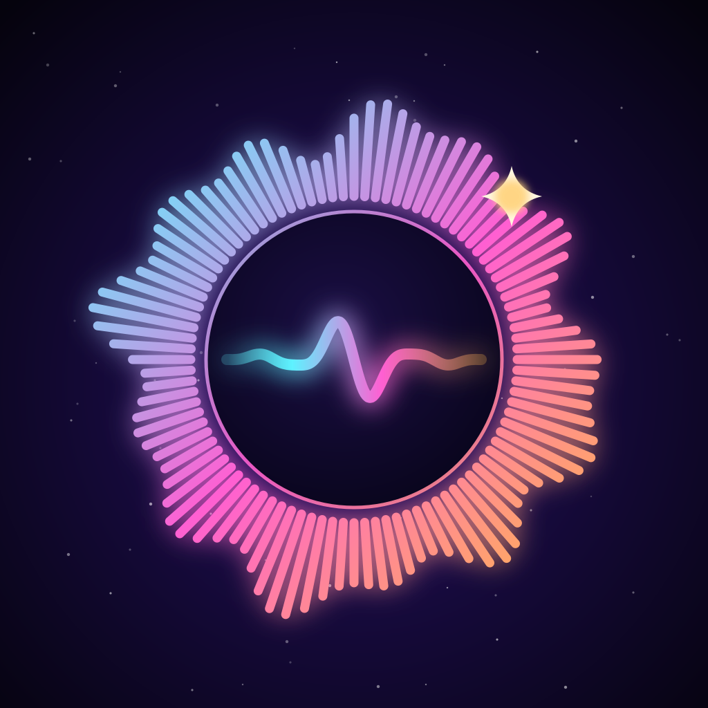

<p align="center">
  
</p>

<h1 align="center">Lumisound</h1>

<p align="center">
  Your music, lit up. A music player for iPhone, Apple Watch and Apple TV with its own sound engine,
  your own cloud library and everything synced between your devices.
</p>

---

## Install

Lumisound is installed with **AltStore** or **SideStore** (or any tool that reads an AltStore source).

1. In AltStore / SideStore, open **Sources** → **Add Source**.
2. Paste:
   ```
   https://raw.githubusercontent.com/VoxeliseStudios/Lumisound/main/ios/altstore-source.json
   ```
3. Install **Lumisound**. Updates appear in the same place.

You can also download the latest `.ipa` from [Releases](https://github.com/VoxeliseStudios/Lumisound/releases/latest)
and install it with Sideloadly or a similar tool.

A free account (made in the app) syncs your favorites, playlists, settings and listening history and
unlocks the cloud library. Everything else works without one.

## What you get

**Sound**
- The Lumisound engine: gapless playback, crossfade and DJ-style Smart Crossfade, speed and pitch.
- LumiEQ with presets for every kind of music and Auto EQ that tunes itself to each song.
- Volume boost that stays clean, Spatial Audio rooms with head tracking, reverb, night mode.
- Effects such as Lo-Fi Tape, AM Radio, Vinyl Night, Underwater, Nightcore and Slowed + Reverb.
- Music Haptics, Skip Silent Intros, ReplayGain.

**Library**
- Import your own files, download from YouTube and SoundCloud, or play straight from your cloud library.
- Tracked playlists and followed channels download new songs for you.
- Duplicate Finder that compares the sound itself, Library Health, backups and a 30-day Recently Deleted.
- Synced lyrics, smart playlists, stats, a yearly Rewind and achievements.

**Now Playing**
- More than 25 animated artwork styles and 11 seeker styles, or design your own.
- Widgets, a Live Activity, Siri and Shortcuts, Focus filters and Car Mode.

**Together**
- Listen Together with friends, shared queues and reactions, profiles, a guestbook and Discord Rich Presence.

**Devices**
- Apple Watch and Apple TV apps signed in to the same account.

## Help

Settings → **Help & Guide** in the app explains every feature. Found a bug? Settings → **Report a Bug**
sends it along with the logs we need.
